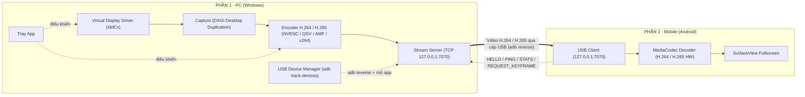
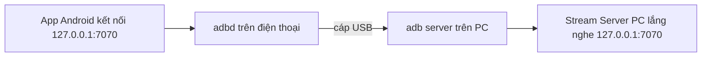
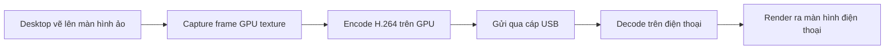
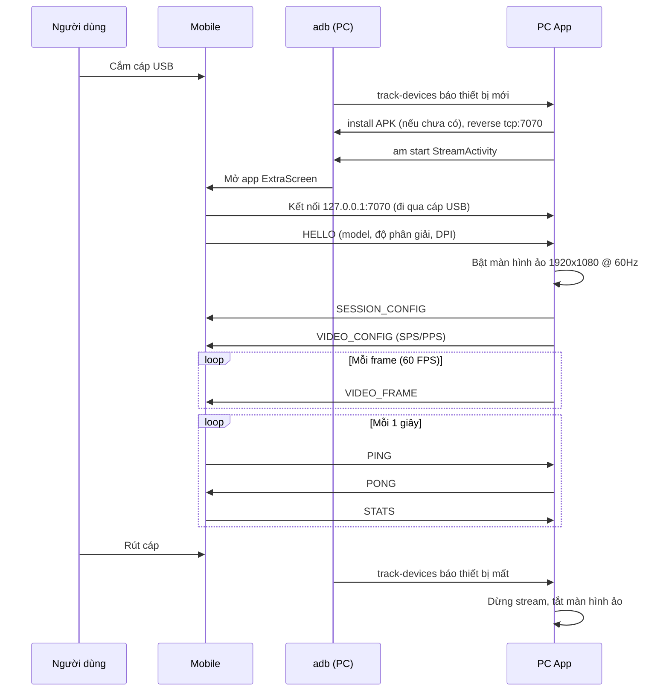

# ExtraScreen – Kế hoạch phát triển ứng dụng

> **Tổng quan:** Biến điện thoại thành **màn hình phụ thật sự** của máy tính (Extend, không chỉ Mirror), **kết nối duy nhất qua cáp USB**. Điện thoại **chỉ làm nhiệm vụ hiển thị hình ảnh** – mọi thao tác vẫn dùng chuột/bàn phím của PC như một màn hình rời bình thường.
>
> Ứng dụng gồm 2 phần:
> - **Phần 1 – PC (Windows):** tạo màn hình ảo → chụp → nén video → gửi qua USB.
> - **Phần 2 – Mobile (Android):** nhận video qua USB → giải nén → hiển thị toàn màn hình.

> [!IMPORTANT]
> **Phạm vi kỹ thuật đã chốt:**
> - **Chỉ dùng USB, không dùng Wi-Fi.** Dữ liệu đi qua cáp bằng cơ chế `adb reverse` (Android Debug Bridge). Không cần mạng, không cần QR – **cắm cáp là chạy**.
> - **Chỉ hiển thị, không có cảm ứng điều khiển PC.** Luồng dữ liệu gần như một chiều PC → điện thoại; chạm trên điện thoại chỉ dùng cho giao diện của chính app (bật/tắt overlay thông số).
> - **Cố định 1920×1080 @ 60 FPS.**

---

## 1. Mục tiêu & phạm vi

### 1.1 Mục tiêu chất lượng
| Tiêu chí | Mục tiêu |
|---|---|
| Độ trễ (glass-to-glass) | **< 50 ms** (con trỏ chuột di chuyển sang màn hình điện thoại không thấy trễ) |
| Độ phân giải / FPS | **Cố định 1920×1080 @ 60 FPS** – không bao giờ giảm độ phân giải hay FPS |
| Kết nối | **Cắm cáp USB → màn hình phụ tự xuất hiện**, không cần thao tác thêm (sau lần thiết lập đầu tiên) |
| Thao tác | Dùng chuột/bàn phím PC, kéo cửa sổ sang điện thoại như màn hình thứ 2 thật |

### 1.2 Lộ trình tính năng theo giai đoạn
| Giai đoạn | Tính năng | Phần |
|---|---|---|
| 🔴 Giai đoạn 1 (Core) | Tạo màn hình ảo (Extend mode) trên Windows | PC |
| 🔴 Giai đoạn 1 (Core) | Chụp màn hình ảo + nén H.264 phần cứng | PC |
| 🔴 Giai đoạn 1 (Core) | Truyền qua USB (`adb reverse` + TCP qua cáp) | PC + Mobile |
| 🔴 Giai đoạn 1 (Core) | Giải mã phần cứng + hiển thị toàn màn hình | Mobile |
| 🟡 Giai đoạn 2 (UX) | **Plug & play:** tự phát hiện cắm cáp, tự `adb reverse`, tự mở app trên điện thoại | PC |
| 🟡 Giai đoạn 2 (UX) | Tự cài APK lên điện thoại nếu chưa có (`adb install`) | PC |
| 🟡 Giai đoạn 2 (UX) | Tray app hiển thị trạng thái, chọn encoder/bitrate, tùy chọn nâng cao **H.265 (HEVC)** | PC + Mobile |
| 🟡 Giai đoạn 2 (UX) | Màn hình hướng dẫn bật USB Debugging | Mobile |
| 🟡 Giai đoạn 2 (UX) | Overlay hiển thị FPS, độ trễ, bitrate | Mobile |
| 🟢 Giai đoạn 3 (Nâng cao) | Capture + encode in-process (bỏ tiến trình `ffmpeg.exe`) để giảm thêm độ trễ | PC |
| 🟢 Giai đoạn 3 (Nâng cao) | Nhiều điện thoại cùng lúc qua nhiều cổng USB (nhiều màn hình ảo) | PC |
| 🟢 Giai đoạn 3 (Nâng cao) | Chế độ **AOA (Android Open Accessory)** – không cần bật USB Debugging | PC + Mobile |

> [!IMPORTANT]
> **Chế độ dự phòng (Mirror mode):** ngoài chế độ mở rộng màn hình (Extend), ứng dụng hỗ trợ thêm chế độ **Mirror** (stream một màn hình vật lý có sẵn) trong trường hợp máy tính không cài được driver màn hình ảo.

### 1.3 Thông số video cố định (bắt buộc)
| Thông số | Giá trị | Lý do |
|---|---|---|
| Độ phân giải màn hình ảo | **1920×1080 (16:9)** – cố định, không phụ thuộc điện thoại | Chuẩn Full HD, Windows hiển thị đẹp, mọi điện thoại đều decode được |
| Tần số màn hình ảo | **60 Hz** | Khớp với FPS stream |
| FPS stream | **60 FPS không đổi** – lặp lại frame cũ khi desktop đứng yên | Chuyển động mượt, nhịp hiển thị đều |
| Codec | **Mặc định: H.264 High** (`video/avc`) · **Tùy chọn nâng cao: H.265 Main** (`video/hevc`), không B-frame, CBR | H.264 tương thích 100% và độ trễ thấp nhất; H.265 tối ưu độ nét chữ ở bitrate thấp |
| Bitrate | **H.264: 20 Mbps** (10–30 Mbps) · **H.265: 12 Mbps** (6–20 Mbps) | USB dư băng thông → ưu tiên chữ/giao diện sắc nét |
| GOP / keyframe | IDR mỗi 2 giây (`-g 120`) + IDR khi client yêu cầu | Phục hồi nhanh khi decoder lỗi |
| Khi điện thoại decode không kịp | **Chỉ hạ bitrate** (tối thiểu 10 Mbps), **giữ nguyên 1080p60** | Đúng yêu cầu cố định khung hình & FPS |

**Ngân sách thời gian cho mỗi frame (60 FPS ⇒ 16,67 ms/frame):** mọi khâu chạy song song dạng pipeline, không khâu nào được vượt 16,67 ms.

| Khâu | Thời gian mục tiêu |
|---|---|
| Capture (GPU) | ≤ 3 ms |
| Encode (NVENC / QSV / AMF) | ≤ 5 ms |
| Truyền qua USB (ADB) | ≤ 3 ms |
| Decode (MediaCodec) | ≤ 8 ms |
| Hiển thị (chờ vsync) | ≤ 16,7 ms |
| **Tổng glass-to-glass** | **~35–45 ms** |

> [!WARNING]
> Điện thoại thường có tỉ lệ 19,5:9 hoặc 20:9, nên khung 16:9 sẽ có **viền đen hai bên (letterbox)**. Đây là đánh đổi có chủ đích để giữ đúng 1920×1080.

---

## 2. Kiến trúc tổng thể



### Cơ chế truyền qua USB

`adb reverse tcp:7070 tcp:7070` khiến cổng `7070` trên điện thoại được chuyển thẳng qua cáp USB tới cổng `7070` trên PC. Hai bên vẫn lập trình như socket TCP bình thường, nhưng dữ liệu **không đi qua mạng nào**.

### Luồng dữ liệu (pipeline)


> [!TIP]
> Giữ frame **luôn ở trên GPU** (capture → encode không copy về CPU) là chìa khóa để đạt độ trễ thấp.

---

## 3. PHẦN 1 – Ứng dụng PC (Windows)

### 3.1 Tech stack đề xuất
| Thành phần | Công nghệ | Ghi chú |
|---|---|---|
| Ngôn ngữ chính | **C# / .NET 8** | Phát triển nhanh, dễ làm UI |
| UI | WPF (Tray icon + cửa sổ Settings) | Trạng thái kết nối, cấu hình |
| Màn hình ảo | **Virtual Display Driver** (IddCx, mã nguồn mở) hoặc Amyuni `usbmmidd` | Dùng driver có sẵn đã ký số (signed driver), kiểm tra license |
| Capture | DXGI Desktop Duplication (qua `Vortice.Windows`) | Lấy frame trực tiếp trên GPU |
| Encode | FFmpeg (H.264: `h264_nvenc`/`qsv`/`amf`/`libx264` · H.265: `hevc_nvenc`/`qsv`/`amf`) | Dùng qua `FFmpeg.AutoGen` hoặc tiến trình `ffmpeg.exe` |
| Kết nối USB | **`adb.exe`** (Android platform-tools) **đóng gói kèm app** | `adb reverse`, `adb track-devices`, `adb install`, `adb shell am start` |
| Socket | `System.Net.Sockets` (TCP, chỉ bind `127.0.0.1`, `NoDelay = true`) | Không mở cổng ra mạng ngoài |

> [!TIP]
> **Cách dựng nguyên mẫu nhanh (Prototype):** FFmpeg ≥ 6.0 có sẵn filter `ddagrab` (Desktop Duplication) – có thể chụp + nén màn hình ảo chỉ bằng 1 lệnh, xuất luồng video thô ra stdout, app C# chỉ cần đọc và đẩy qua socket:
> ```bash
> # Mặc định (H.264 - 20 Mbps):
> ffmpeg -f lavfi -i ddagrab=output_idx=1:framerate=60:video_size=1920x1080:dup_frames=1:draw_mouse=1 \
>        -c:v h264_nvenc -preset p1 -tune ull -zerolatency 1 -bf 0 -g 120 \
>        -rc cbr -b:v 20M -maxrate 20M -bufsize 500k -f h264 -
>
> # Tùy chọn nâng cao (H.265 / HEVC - 12 Mbps):
> ffmpeg -f lavfi -i ddagrab=output_idx=1:framerate=60:video_size=1920x1080:dup_frames=1:draw_mouse=1 \
>        -c:v hevc_nvenc -preset p1 -tune ull -zerolatency 1 -bf 0 -g 120 \
>        -rc cbr -b:v 12M -maxrate 12M -bufsize 400k -f hevc -
> ```
> `dup_frames=1` lặp lại frame khi màn hình đứng yên để giữ **đúng 60 FPS**. Sau khi pipeline chạy thông suốt end-to-end, có thể chuyển sang capture/encode in-process để tối ưu thêm.

### 3.2 Các module

#### M1 – Virtual Display Manager
- Cài / bật / tắt driver màn hình ảo (script PowerShell, cần quyền Admin lần đầu).
- Đặt màn hình ảo **cố định 1920×1080 @ 60 Hz** (khai báo trong file cấu hình của driver), không đổi theo điện thoại.
- Đặt Windows scaling của màn hình ảo ở 100–125% để chữ dễ đọc trên màn hình điện thoại nhỏ.
- **Bật màn hình ảo khi điện thoại cắm vào, tắt khi rút cáp** → hành vi giống cắm/rút màn hình thật.
- Lấy chỉ số output của màn hình ảo để capture đúng màn hình.
- **Fallback Mirror mode:** chọn một màn hình vật lý bất kỳ.

#### M2 – Screen Capture
- DXGI `IDXGIOutputDuplication` trên output của màn hình ảo.
- **Bắt buộc vẽ con trỏ chuột** vào frame (Desktop Duplication không tự vẽ cursor → lấy `PointerShape` và vẽ chồng, hoặc `draw_mouse=1` với `ddagrab`) – vì người dùng điều khiển màn hình phụ bằng chuột PC.
- Chụp theo **nhịp cố định 60 FPS** (timer 16,67 ms): Desktop Duplication chỉ trả frame khi màn hình thay đổi, nên nếu không có frame mới thì **gửi lại frame cũ** để giữ đúng 60 FPS.
- Giữ frame trên GPU (D3D11 texture) và đưa thẳng vào encoder, không copy về CPU.

#### M3 – Video Encoder
- Độ phân giải **1920×1080, 60 FPS cố định**, **không B-frame**, preset low-latency, CBR.
- **Hai chế độ Codec:**
  - **H.264 (Mặc định – 20 Mbps):** ưu tiên độ trễ thấp nhất và tương thích tuyệt đối. Tự chọn theo GPU: `h264_nvenc` / `h264_qsv` / `h264_amf`, fallback CPU `libx264 -preset ultrafast -tune zerolatency`. Trích xuất `SPS + PPS` gửi trong gói `VIDEO_CONFIG`.
  - **H.265 / HEVC (Tùy chọn nâng cao – 12 Mbps):** tối ưu độ sắc nét cho văn bản/UI ở bitrate thấp và giảm kích thước keyframe. Chỉ cho phép bật khi **cả GPU trên PC** (`hevc_nvenc` / `hevc_qsv` / `hevc_amf`) **và điện thoại** (báo qua gói `HELLO`) đều hỗ trợ phần cứng HEVC (không dùng `libx265` CPU để tránh tụt dưới 60 FPS). Trích xuất đủ bộ 3 `VPS + SPS + PPS` gửi trong gói `VIDEO_CONFIG`.
- Hỗ trợ lệnh **yêu cầu keyframe (IDR)** khi client mới kết nối hoặc decoder lỗi.
- Chỉ hạ bitrate khi điện thoại báo decode không kịp, **không bao giờ đổi độ phân giải hay FPS**.

#### M4 – USB Device Manager
- Khởi động `adb.exe` đóng gói kèm (tránh xung đột phiên bản với adb của Android Studio).
- Theo dõi cắm/rút thiết bị bằng `adb track-devices` (sự kiện realtime, không cần polling).
- Khi phát hiện điện thoại ở trạng thái `device`:
  1. Kiểm tra app đã cài chưa (`adb shell pm list packages com.extrascreen`) → nếu chưa thì `adb install -r extrascreen.apk`.
  2. `adb -s <serial> reverse tcp:7070 tcp:7070`.
  3. Mở app: `adb shell am start -n com.extrascreen/.stream.StreamActivity`.
  4. Bật màn hình ảo (M1) và bắt đầu stream.
- Khi điện thoại ở trạng thái `unauthorized` → hiện thông báo trên tray: *"Hãy bấm **Cho phép** gỡ lỗi USB trên điện thoại"*.
- Khi rút cáp → dừng stream, tắt màn hình ảo, gỡ `adb reverse`.

#### M5 – Stream Server
- TCP server **chỉ bind `127.0.0.1:7070`** (không mở ra mạng, an toàn), tắt Nagle (`NoDelay`).
- Gửi video và cấu hình; chỉ nhận vài gói điều khiển nhỏ từ điện thoại (xem mục 5).
- Hỗ trợ 1 client kết nối tại một thời điểm ở phiên bản đầu.

#### M6 – Tray App / UI
- Icon khay hệ thống với trạng thái: *Chưa cắm điện thoại* / *Chờ cho phép USB Debugging* / *Đang stream* / *Lỗi*.
- Cửa sổ Settings:
  - Cơ bản: chế độ Extend/Mirror, bitrate, bộ encoder phần cứng. Độ phân giải **1920×1080** và **60 FPS** hiển thị dạng chỉ đọc (không cho đổi).
  - **Advanced Settings:** tùy chọn chuyển đổi Codec giữa **H.264 (Mặc định - Độ trễ thấp nhất)** và **H.265 / HEVC (Nâng cao - Tối ưu độ nét/băng thông)**; tự động làm mờ (disable) tùy chọn H.265 nếu GPU hoặc điện thoại không hỗ trợ giải mã phần cứng.
- Hiển thị tên điện thoại đang kết nối (model + serial), nút Ngắt kết nối.

### 3.3 Cấu trúc thư mục PC
```
pc/
├── ExtraScreen.sln
├── src/
│   ├── ExtraScreen.App/          # M6 - WPF tray app, Settings
│   ├── ExtraScreen.Core/         # Pipeline điều phối, cấu hình
│   ├── ExtraScreen.Display/      # M1 - quản lý màn hình ảo
│   ├── ExtraScreen.Capture/      # M2 - DXGI Desktop Duplication
│   ├── ExtraScreen.Encoding/     # M3 - FFmpeg wrapper
│   ├── ExtraScreen.Usb/          # M4 - adb track-devices, reverse, install, start app
│   ├── ExtraScreen.Server/       # M5 - TCP server 127.0.0.1:7070
│   └── ExtraScreen.Protocol/     # Định nghĩa gói tin (dùng chung spec với mobile)
├── drivers/                      # Script cài virtual display driver
├── tools/                        # adb.exe (+ AdbWinApi.dll, AdbWinUsbApi.dll), ffmpeg.exe, extrascreen.apk
└── tests/
```

---

## 4. PHẦN 2 – Ứng dụng Mobile (Android)

### 4.1 Tech stack đề xuất
| Thành phần | Công nghệ | Ghi chú |
|---|---|---|
| Ngôn ngữ | **Kotlin** (native Android) | Truy cập trực tiếp MediaCodec → độ trễ thấp nhất |
| UI | Jetpack Compose (màn hình hướng dẫn) + `SurfaceView` (stream) | `SurfaceView` nhanh hơn `TextureView` |
| Decode | `MediaCodec` phần cứng (`video/avc` cho H.264, `video/hevc` cho H.265), bật `KEY_LOW_LATENCY` (Android 11+) | |
| Kết nối | Kotlin Coroutines + `java.net.Socket` tới `127.0.0.1:7070` (`tcpNoDelay = true`) | Cổng này được `adb reverse` chuyển qua cáp USB |
| Quyền | Chỉ cần quyền `INTERNET` (để mở socket localhost) | Không cần camera, không cần Wi-Fi |
| minSdk | 26 (Android 8.0) | |

> [!NOTE]
> Chỉ phát triển cho Android vì cơ chế `adb reverse` chỉ có trên Android. Nếu muốn mở rộng sang iOS về sau sẽ cần dùng `usbmuxd` để truyền qua USB.

### 4.2 Các màn hình
1. **Onboarding (chỉ lần đầu):** hướng dẫn từng bước bật *Tùy chọn nhà phát triển* → *Gỡ lỗi USB*, nút mở thẳng trang cài đặt Developer Options.
2. **Waiting:** "Hãy cắm cáp USB vào máy tính" + hoạt ảnh, app tự thử kết nối liên tục.
3. **Stream (fullscreen):** chỉ có video, chế độ immersive (ẩn status/navigation bar), giữ màn hình luôn sáng.
4. **Overlay thông số:** chạm 2 lần để bật/tắt – hiển thị FPS, độ trễ, bitrate, nút ngắt kết nối. *(Thao tác chạm chỉ điều khiển app, không gửi gì sang PC.)*

### 4.3 Các module

#### A1 – USB Connection Manager
- Liên tục thử kết nối `127.0.0.1:7070` mỗi 500 ms cho tới khi PC thiết lập xong `adb reverse`.
- Kiểm tra `MediaCodecList` xem thiết bị có decoder phần cứng `video/hevc` (H.265) hay không, sau đó gửi gói `HELLO`: model, độ phân giải thật, DPI, danh sách codec phần cứng hỗ trợ (`["h264", "h265"]`), phiên bản app.
- Mất kết nối (rút cáp) → quay về màn hình Waiting và tự kết nối lại khi cắm cáp.
- Kiểm tra `Settings.Global.ADB_ENABLED` để biết USB Debugging đã bật chưa → nếu chưa thì hiện Onboarding.

#### A2 – Video Decoder
- Đọc trường `codec` từ gói `SESSION_CONFIG` (`"h264"` → khởi tạo `MediaCodec` với `"video/avc"`, `"h265"` → khởi tạo với `"video/hevc"`).
- Nhận gói `VIDEO_CONFIG` (chứa `SPS + PPS` với H.264, hoặc `VPS + SPS + PPS` với H.265) → đưa vào `csd-0` để cấu hình `MediaCodec` 1920×1080.
- Đẩy từng NAL unit vào input buffer ngay khi nhận; output render thẳng lên `Surface` (`releaseOutputBuffer(index, true)`), **không giữ hàng đợi frame**.
- Nếu decoder lỗi/mất đồng bộ → gửi `REQUEST_KEYFRAME`.

#### A3 – Renderer
- `SurfaceView` fullscreen, buffer cố định 1920×1080, **luôn khóa hướng ngang**, giữ đúng tỉ lệ 16:9 (letterbox viền đen nếu điện thoại dài hơn).
- Đặt `FLAG_KEEP_SCREEN_ON`, chế độ immersive sticky.
- Đặt tần số quét màn hình điện thoại **60 Hz hoặc bội số của 60** (60/120 Hz) qua `preferredDisplayModeId` để frame hiển thị đều, không bị giật (judder) như ở 90 Hz.

#### A4 – Stats & Overlay
- Đo RTT bằng `PING/PONG`, FPS hiển thị, thời gian decode, bitrate nhận.
- Gửi số liệu về PC để PC hạ bitrate nếu decode không kịp.

### 4.4 Cấu trúc thư mục Mobile
```
mobile/
├── app/src/main/java/com/extrascreen/
│   ├── ui/              # Compose: Onboarding, Waiting, Overlay
│   ├── stream/          # StreamActivity, SurfaceView, Renderer (A3)
│   ├── decoder/         # MediaCodec wrapper (A2)
│   ├── connection/      # Socket client localhost + reconnect (A1)
│   ├── protocol/        # Định nghĩa gói tin
│   └── stats/           # FPS, latency (A4)
└── build.gradle.kts
```

---

## 5. Giao thức truyền thông (dùng chung 2 phần)

### 5.1 Định dạng gói tin (little-endian)
```
+--------+-----------+---------------+-----------------+
| type   | length    | timestamp_us  | payload         |
| 1 byte | 4 bytes   | 8 bytes       | length bytes    |
+--------+-----------+---------------+-----------------+
```

| Type | Tên | Hướng | Payload |
|---|---|---|---|
| `0x01` | `HELLO` | Mobile → PC | JSON: model, width, height, dpi, codecs (`["h264", "h265"]`), version |
| `0x02` | `SESSION_CONFIG` | PC → Mobile | JSON: width = 1920, height = 1080, fps = 60, codec (`"h264"` \| `"h265"`), bitrate |
| `0x10` | `VIDEO_CONFIG` | PC → Mobile | Annex-B header: `SPS + PPS` (H.264) hoặc `VPS + SPS + PPS` (H.265) |
| `0x11` | `VIDEO_FRAME` | PC → Mobile | 1 byte cờ (keyframe) + NAL units |
| `0x12` | `REQUEST_KEYFRAME` | Mobile → PC | rỗng |
| `0x30` / `0x31` | `PING` / `PONG` | 2 chiều | timestamp gốc |
| `0x40` | `STATS` | Mobile → PC | fps, decodeMs, rttMs |
| `0xFF` | `BYE` | 2 chiều | lý do |

> [!NOTE]
> Không có gói input/cảm ứng. Chiều Mobile → PC chỉ gồm các gói điều khiển rất nhỏ (vài byte/giây).

### 5.2 Luồng kết nối USB


> [!NOTE]
> **Bảo mật:** không có cổng nào mở ra mạng (server chỉ bind `127.0.0.1`). Việc xác thực do ADB đảm nhận: điện thoại phải bấm **"Cho phép gỡ lỗi USB"** với khóa RSA của PC ở lần cắm đầu tiên.

---

## 6. Lộ trình triển khai kỹ thuật

| Bước | Phần PC | Phần Mobile | Kết quả cần đạt |
|---|---|---|---|
| **Bước 1: Chuẩn bị** | Khởi tạo solution, chốt spec protocol, cài thử driver màn hình ảo | Khởi tạo project Android, dựng khung UI, bật USB Debugging trên máy test | ✅ Spec giao thức đã chốt, `adb devices` nhận diện được điện thoại |
| **Bước 2: Truyền hình cơ bản** | Dùng `ddagrab` + FFmpeg đẩy H.264 qua TCP server, chạy `adb reverse` thủ công | Socket client localhost + `MediaCodec` decode lên `SurfaceView` | ✅ **Thấy hình desktop trên điện thoại qua USB** |
| **Bước 3: Màn hình ảo 1080p60** | Chuyển sang capture màn hình ảo (Extend) 1920×1080 @ 60 Hz, giữ nhịp 60 FPS cố định, vẽ con trỏ chuột | Fullscreen immersive, letterbox 16:9, khóa ngang, gửi `HELLO` | ✅ Điện thoại hoạt động như màn hình thứ 2, **đạt 60 FPS ổn định** |
| **Bước 4: Plug & Play** | Tự động hóa với `adb track-devices`, tự `reverse`, tự mở app, tự cài APK | Màn hình Waiting, tự kết nối lại khi cắm/rút, màn hình Onboarding | ✅ **Cắm cáp → màn hình phụ tự xuất hiện** |
| **Bước 5: Giao diện & Đo đạc** | Tray app, cửa sổ Settings, tự chọn encoder theo GPU | Overlay hiển thị FPS/latency, gửi `REQUEST_KEYFRAME` khi lỗi | ✅ Theo dõi được độ trễ và trạng thái trực quan |
| **Bước 6: Tối ưu & Đóng gói** | Xử lý `ACCESS_LOST`, tối ưu capture/encode in-process, đóng gói bộ cài (kèm adb + APK) | Tối ưu tần số quét 60/120 Hz, kiểm thử trên nhiều hãng máy, build APK release | ✅ Ứng dụng chạy ổn định trong thời gian dài |

---

## 7. Rủi ro kỹ thuật & cách xử lý

| Rủi ro | Mức độ | Phương án xử lý |
|---|---|---|
| Driver màn hình ảo không cài được / bị chặn bởi Secure Boot, antivirus | Cao | Đóng gói script cài đặt rõ ràng; hỗ trợ sẵn chế độ **Mirror mode** làm phương án thay thế |
| Cáp USB chỉ sạc, không truyền dữ liệu | Cao | Sử dụng cáp truyền dữ liệu đạt chuẩn; app PC hiển thị cảnh báo nếu không nhận được tín hiệu dữ liệu |
| Windows thiếu driver ADB cho một số hãng (Samsung, Xiaomi…) | Trung bình | Tích hợp hoặc hướng dẫn cài Google USB Driver / driver OEM trong tài liệu hướng dẫn |
| Xung đột phiên bản adb (Android Studio, scrcpy đang chạy) | Trung bình | Dùng `adb.exe` đóng gói riêng; xử lý khởi động lại adb server khi phát hiện xung đột版本 |
| Điện thoại chưa bấm "Cho phép gỡ lỗi USB" | Trung bình | Tray app phát hiện trạng thái `unauthorized` và hiện hướng dẫn trực quan cho người dùng |
| Máy không có GPU encoder → không giữ nổi 1080p60 | Trung bình | Ưu tiên GPU encoder (NVENC/QSV/AMF); fallback sang `libx264 ultrafast zerolatency` ở 1080p60 và giảm bitrate |
| Con trỏ chuột không hiện trên màn hình điện thoại | Trung bình | Bật `draw_mouse=1` hoặc tự vẽ `PointerShape` từ Desktop Duplication |
| Điện thoại tần số quét 90 Hz gây giật nhịp | Thấp | Ép màn hình điện thoại về 60 Hz hoặc 120 Hz |
| Decoder một số máy Android buffer nhiều frame → trễ | Trung bình | Bật `KEY_LOW_LATENCY`, giảm GOP, kiểm thử trên nhiều dòng chip (Snapdragon, MediaTek, Exynos) |
| Desktop Duplication mất quyền (khi hiện UAC hoặc khóa màn hình) | Thấp | Bắt lỗi `ACCESS_LOST` và tự động khởi tạo lại phiên capture |

---

## 8. Danh sách kiểm tra hoàn thiện (Release Checklist)
- [ ] Pipeline video end-to-end qua USB chạy ổn định liên tục
- [ ] Giữ **1920×1080 @ 60 FPS** liên tục (FPS không tụt dưới 58)
- [ ] Extend mode hoạt động chuẩn xác, con trỏ chuột hiển thị mượt trên điện thoại
- [ ] Cắm/rút cáp nhiều lần liên tiếp đều tự kết nối và bật/tắt màn hình ảo đúng cách
- [ ] Kiểm thử tương thích trên ít nhất 2 hãng điện thoại khác nhau
- [ ] Đóng gói bộ cài PC (kèm `adb.exe` + APK) và bản build APK release
- [ ] Hoàn thiện tài liệu README: hướng dẫn bật USB Debugging, cách cài đặt, sử dụng và kiến trúc hệ thống
