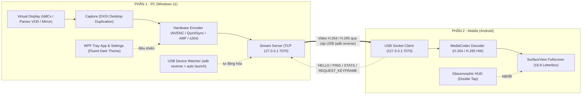

# ExtraScreen – Màn hình phụ USB cho Máy tính (1080p @ 60 FPS)

> **ExtraScreen** biến điện thoại Android thành **màn hình phụ thật sự** của máy tính Windows (hỗ trợ cả **Extend Display** và **Mirror Display**), **kết nối duy nhất qua cáp USB Type-C** thông qua cơ chế `adb reverse`.
> 
> ⚡ **Độ trễ cực thấp (< 50 ms)** · 🔒 **Cố định 1920×1080 @ 60 FPS** · 🔌 **Cắm cáp là chạy (Plug & Play, không cần Wi-Fi, không cần quét QR)** · 🖱️ **Điện thoại chỉ làm nhiệm vụ hiển thị, thao tác chuột/bàn phím PC như màn hình rời.**

---

## 1. Kiến trúc hệ thống & Luồng truyền tải



### Ngân sách thời gian mỗi khung hình (Glass-to-Glass Pipeline)
| Khâu xử lý | Thời gian mục tiêu | Ghi chú |
|---|---|---|
| **Capture (GPU)** | ≤ 3 ms | DXGI Desktop Duplication trực tiếp trên VRAM |
| **Encode phần cứng** | ≤ 5 ms | NVIDIA NVENC / Intel QuickSync / AMD AMF |
| **Truyền cáp USB** | ≤ 3 ms | Localhost TCP qua `adb reverse` (băng thông cáp Type-C) |
| **Decode MediaCodec** | ≤ 8 ms | Hardware decoder với cờ `KEY_LOW_LATENCY` |
| **Vsync & Hiển thị** | ≤ 16.7 ms | SurfaceView khóa 60 Hz / 120 Hz |
| **TỔNG ĐỘ TRỄ** | **~35 – 45 ms** | Di chuột mượt mà, không thấy bóng ma hay khựng hình |

---

## 2. Cấu trúc mã nguồn

```
ExtraScreen/
├── PLAN.md                          # Kế hoạch & đặc tả kỹ thuật chi tiết
├── UI_DESIGN.md                     # Bản thiết kế UI/UX wireframe & hệ màu
├── ui-design.html                   # Bản mẫu mockup giao diện tương tác trực quan
├── README.md                        # Hướng dẫn cài đặt & vận hành
│
├── pc/                              # Ứng dụng PC (C# .NET 8 / WPF)
│   ├── ExtraScreen.slnx             # Solution .NET 8
│   ├── src/
│   │   ├── ExtraScreen.Protocol/    # Đặc tả gói tin (HELLO, CONFIG, FRAME, PING/PONG, STATS)
│   │   ├── ExtraScreen.Usb/         # ADB client, track-devices, reverse port, auto install
│   │   ├── ExtraScreen.Display/     # Enum display, Extend vs Mirror mode, VDD detector
│   │   ├── ExtraScreen.Encoding/    # FFmpeg stream pipeline, phát hiện GPU NVENC/QSV/AMF/x264
│   │   ├── ExtraScreen.Capture/     # DXGI duplication & cursor overlay
│   │   ├── ExtraScreen.Server/      # TCP stream server bind 127.0.0.1:7070 (NoDelay)
│   │   ├── ExtraScreen.Core/        # Điều phối pipeline, quản lý trạng thái, lưu cài đặt
│   │   └── ExtraScreen.App/         # Giao diện WPF Fluent Dark Theme + Khay hệ thống (Tray)
│   ├── drivers/                     # Script PowerShell kiểm tra & cài đặt driver màn hình ảo
│   ├── tools/                       # adb.exe (+ AdbWinApi.dll, AdbWinUsbApi.dll) đóng gói kèm
│   └── tests/
│       └── ExtraScreen.Tests/       # Unit test bộ giao thức & serialization (xUnit)
│
└── mobile/                          # Ứng dụng Android (Kotlin + Jetpack Compose)
    ├── build.gradle.kts             # Cấu hình build Gradle 8.13
    ├── settings.gradle.kts
    ├── gradlew / gradlew.bat        # Gradle wrapper
    └── app/src/main/
        ├── AndroidManifest.xml      # Khóa xoay ngang, immersive fullscreen, KEEP_SCREEN_ON
        └── java/com/extrascreen/
            ├── protocol/            # Bộ parser/writer gói tin little-endian
            ├── connection/          # UsbClient kết nối localhost:7070 & tự kết nối lại
            ├── decoder/             # MediaCodec phần cứng (H.264 & H.265) xuất ra SurfaceView
            ├── stats/               # Đo đạc FPS, RTT độ trễ và bitrate thời gian thực
            ├── ui/                  # Compose UI: Onboarding, Waiting, Glassmorphic HUD, Theme
            └── stream/              # StreamActivity điều phối toàn màn hình và gesture
```

---

## 3. Hướng dẫn cài đặt & Chạy ứng dụng

### 3.1 Phần 1: Ứng dụng PC (Windows)

#### Yêu cầu hệ thống:
- Windows 10/11 (64-bit).
- Đã cài đặt **.NET 8.0 SDK** trở lên.
- Card đồ họa có hỗ trợ Hardware Encoder (NVIDIA GTX/RTX, Intel HD/Iris/Arc, hoặc AMD Radeon).
- Đã có FFmpeg (ứng dụng tự động nhận diện từ WinGet hoặc thư mục tools).

#### Build & Chạy trên PC:
```powershell
# Chạy unit tests kiểm tra giao thức
dotnet test pc/tests/ExtraScreen.Tests/ExtraScreen.Tests.csproj

# Build toàn bộ solution
dotnet build pc/ExtraScreen.slnx

# Chạy ứng dụng giao diện PC
dotnet run --project pc/src/ExtraScreen.App/ExtraScreen.App.csproj
```

Ứng dụng PC sẽ xuất hiện với giao diện **Fluent Dark Theme** hiện đại và thu nhỏ vào Khay hệ thống (System Tray).

---

### 3.2 Phần 2: Ứng dụng Mobile (Android)

#### Yêu cầu:
- Điện thoại Android chạy phiên bản 8.0 (Oreo) trở lên (khuyến nghị Android 11+).
- Cáp USB dữ liệu Type-C (cáp truyền được data, không dùng cáp chỉ sạc).

#### Build APK:
```powershell
cd mobile
./gradlew.bat assembleDebug
```
File APK xuất xưởng tại: `mobile/app/build/outputs/apk/debug/app-debug.apk`.

---

## 4. Hướng dẫn sử dụng thực tế (Plug & Play)

### Bước 1: Kích hoạt Gỡ lỗi USB (Chỉ làm 1 lần duy nhất trên điện thoại)
1. Mở app **ExtraScreen** trên điện thoại: App sẽ hiện màn hình **Onboarding**.
2. Nhấn nút **"⚙️ MỞ CÀI ĐẶT NHÀ PHÁT TRIỂN NGAY"**.
3. Bật mục **"Gỡ lỗi qua USB (USB Debugging)"**.

### Bước 2: Cắm cáp USB nối điện thoại với PC
1. Khi cắm cáp lần đầu, điện thoại sẽ hiện popup: *"Cho phép gỡ lỗi USB từ máy tính này?"*.
2. Tích vào ô **"Luôn cho phép từ máy tính này"** và bấm **OK / Cho phép**.
3. **App PC sẽ tự động:**
   - Nhận diện model thiết bị (ví dụ: *Samsung Galaxy S23 Ultra*).
   - Thiết lập cổng `adb reverse tcp:7070 tcp:7070`.
   - Tự động mở app ExtraScreen trên điện thoại.
   - Bắt đầu truyền video màn hình phụ 1080p @ 60 FPS tức thì.

### Bước 3: Trải nghiệm & Tùy biến
- **Di chuyển chuột:** Chuột PC có thể trỏ sang màn hình điện thoại mượt mà, kéo cửa sổ Word, Excel, trình duyệt, video sang điện thoại như một màn hình rời thứ 2.
- **Bật/Tắt HUD thông số trên điện thoại:** **Chạm 2 lần (Double Tap)** vào màn hình để bật hoặc ẩn bảng điều khiển kính mờ (hiển thị FPS, độ trễ ms, bitrate, nút yêu cầu khung hình IDR và nút ngắt kết nối).
- **Chế độ hiển thị:**
  - **Màn hình mở rộng (Extend Display):** Mở rộng không gian làm việc độc lập (khuyến nghị).
  - **Màn hình phản chiếu (Mirror Display):** Phản chiếu nguyên màn hình chính (dành cho máy bị chặn quyền cài driver).
- **Tùy chọn Codec:**
  - **H.264 (Mặc định):** Độ trễ thấp nhất (<40ms), tương thích 100% mọi thiết bị Android.
  - **H.265 / HEVC (Nâng cao):** Tối ưu độ sắc nét cho văn bản/giao diện ở bitrate thấp, tiết kiệm pin.

---

## 5. Giấy phép
Dự án được phát triển theo kiến trúc mở, phục vụ nhu cầu biến thiết bị di động thành màn hình phụ USB hiệu năng cao.
