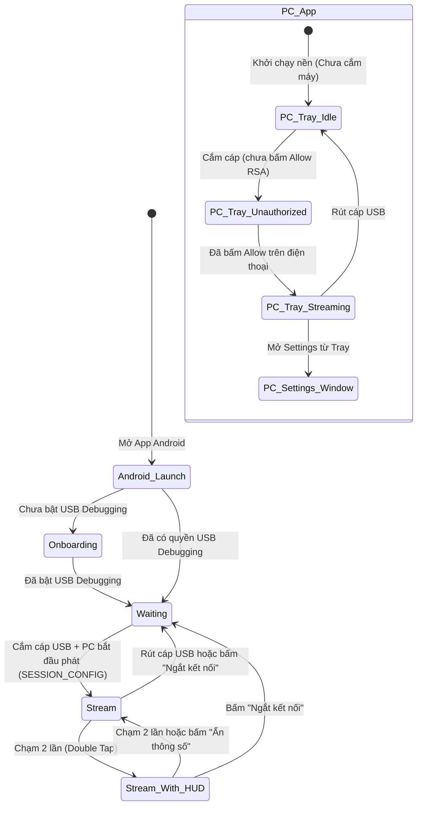

# ExtraScreen – Bản thiết kế Giao diện Người dùng (UI/UX Specification)

> Tài liệu này mô tả chi tiết giao diện, layout wireframe, luồng tương tác và ngôn ngữ thiết kế cho ứng dụng **ExtraScreen** (bao gồm cả **Ứng dụng PC Windows** và **Ứng dụng Mobile Android**) dựa trên đặc tả kỹ thuật từ [plan.md](file:///d:/Code/MyCode/ExtraScreen/plan.md).
>
> 💡 *Bạn cũng có thể mở file `ui-design.html` cùng thư mục trên trình duyệt để trải nghiệm bản dựng giao diện trực quan và tương tác (Interactive High-Fidelity Mockup).*

---

## 1. Nguyên tắc thiết kế & Hệ màu (Design System)

### 1.1 Tôn chỉ thiết kế
- **PC (Windows 11 Fluent Design):** Giao diện dạng khay hệ thống (System Tray) gọn nhẹ, hiện đại, hỗ trợ Dark/Light mode tự động, bo góc 8px–12px, hiệu ứng mica/acrylic tinh tế. Mọi thiết lập quan trọng đều trực quan với trạng thái phần cứng hiển thị rõ ràng.
- **Mobile (Android Material 3 & Minimal Immersive):**
  - **Màn hình chờ/hướng dẫn:** Rõ ràng, trực quan, thân thiện với người dùng không rành kỹ thuật.
  - **Màn hình Stream:** Tối giản 100% (Zero UI Clutter). Khi stream, toàn bộ màn hình dành cho hiển thị desktop với dải letterbox đối xứng màu đen sâu `#000000`.
  - **HUD Overlay:** Kính mờ (Glassmorphism), xuất hiện khi chạm 2 lần (Double Tap) mà không làm gián đoạn trải nghiệm hiển thị.

### 1.2 Bảng màu chủ đạo (Color Palette)

| Mã màu | Tên màu | Mục đích sử dụng |
|---|---|---|
| `#0F172A` | Slate 900 | Nền ứng dụng PC (Dark theme), viền letterbox Android |
| `#1E293B` | Slate 800 | Nền thẻ (Card), Container, cửa sổ phụ |
| `#2563EB` | Royal Blue | Màu thương hiệu chính, nút Action, kết nối thành công |
| `#10B981` | Emerald Green | Trạng thái đang stream, 60 FPS, độ trễ tốt (<50ms) |
| `#F59E0B` | Amber Yellow | Chờ cấp quyền USB Debugging (Unauthorized), cảnh báo |
| `#EF4444` | Crimson Red | Mất kết nối, lỗi encoder, nút ngắt kết nối khẩn |
| `#94A3B8` | Slate 400 | Text thứ cấp, thông số bổ trợ, icon phụ |
| `#FFFFFF` | Pure White | Text chính, con trỏ chuột, biểu tượng nổi bật |

---

## 2. Phần 1: Giao diện Ứng dụng PC (Windows 11)

Ứng dụng PC gồm 2 thành phần giao diện chính:
1. **Khay hệ thống (System Tray Icon & Quick Menu):** Nơi người dùng quan sát trạng thái tức thời và truy cập nhanh.
2. **Cửa sổ Cài đặt chính (Settings Window):** Thiết lập màn hình ảo, codec, bitrate, và quản lý thiết bị.

---

### 2.1 Khay hệ thống (System Tray) & Menu ngữ cảnh

#### Các trạng thái của Tray Icon:
- ⚪ **Màu xám:** Chưa kết nối điện thoại (Idle / Waiting for device).
- 🟡 **Màu vàng (nhấp nháy):** Phát hiện điện thoại nhưng chưa xác thực USB Debugging (`unauthorized`).
- 🟢 **Màu xanh lục:** Đang stream ổn định 1080p60 tới điện thoại.
- 🔴 **Màu đỏ:** Mất kết nối đột ngột hoặc lỗi khởi tạo driver màn hình ảo.

#### Wireframe Menu chuột phải Tray Icon:
```
+-----------------------------------------------------+
|  🖥️ ExtraScreen v1.0.0                              |
|  🟢 Đang stream: Galaxy S23 Ultra (1080p @ 60fps)   |
+-----------------------------------------------------+
|  (•) Chế độ mở rộng (Extend Display)                |
|  ( ) Chế độ phản chiếu (Mirror Display)            |
+-----------------------------------------------------+
|  ⚙️ Cài đặt chi tiết...                             |
|  🔄 Khởi động lại luồng stream                      |
|  🔌 Ngắt kết nối thiết bị                           |
+-----------------------------------------------------+
|  ❌ Thoát ứng dụng                                  |
+-----------------------------------------------------+
```

---

### 2.2 Cửa sổ Cài đặt chính (PC Settings Window)

Cửa sổ được thiết kế theo phong cách Windows 11 Settings (thanh bên tinh gọn hoặc chia cụm thẻ dọc tiện dụng).

#### Wireframe Cửa sổ Cài đặt:
```
+---------------------------------------------------------------------------------------+
|  [📺] ExtraScreen - Cài đặt màn hình phụ USB                             [-] [口] [X] |
+---------------------------------------------------------------------------------------+
|                                                                                       |
|  +---------------------------------------------------------------------------------+  |
|  | 📱 THIẾT BỊ ĐANG KẾT NỐI                                                        |  |
|  |                                                                                 |  |
|  |   [ 📱 ]  Samsung Galaxy S23 Ultra (SM-S918B)        [🟢 ĐÃ KẾT NỐI (USB)]      |  |
|  |           Mã thiết bị: R5CT109ABCD | Cổng nội bộ: 127.0.0.1:7070 (adb reverse)  |  |
|  |           Độ trễ: ~38ms | Bitrate thực tế: 19.8 Mbps | FPS: 60/60               |  |
|  |                                                                                 |  |
|  |   [ 🔄 Khởi động lại luồng ]                [ 🔌 Ngắt kết nối ]                |  |
|  +---------------------------------------------------------------------------------+  |
|                                                                                       |
|  +---------------------------------------------------------------------------------+  |
|  | 🖥️ CẤU HÌNH MÀN HÌNH HIỂN THỊ                                                   |  |
|  |                                                                                 |  |
|  |   Chế độ hiển thị:                                                              |  |
|  |   (•) Màn hình mở rộng (Extend Display) - [Khuyến nghị]                         |  |
|  |       Tạo một màn hình ảo độc lập trên Windows để kéo cửa sổ ứng dụng sang.     |  |
|  |   ( ) Màn hình phản chiếu (Mirror Display)                                      |  |
|  |       Phản chiếu một màn hình vật lý có sẵn (Dùng khi máy bị chặn cài driver).   |  |
|  |                                                                                 |  |
|  |   Độ phân giải: [ 1920 x 1080 (16:9) 🔒 Cố định ]                                |  |
|  |   Tần số quét:  [ 60 Hz 🔒 Cố định ]                                             |  |
|  |                                                                                 |  |
|  |   Độ thu phóng Windows (Scaling):                                               |  |
|  |   [ (•) 100% (Tiêu chuẩn)   ( ) 125% (Chữ to dễ đọc hơn trên màn hình nhỏ) ]     |  |
|  +---------------------------------------------------------------------------------+  |
|                                                                                       |
|  +---------------------------------------------------------------------------------+  |
|  | ⚡ MÃ HÓA & CHẤT LƯỢNG STREAM                                                    |  |
|  |                                                                                 |  |
|  |   Chuẩn nén Video (Codec):                                                      |  |
|  |   [ (•) H.264 High (Mặc định)           ]  [ ( ) H.265 / HEVC (Nâng cao)      ]  |  |
|  |     Độ trễ thấp nhất (<40ms),                 Tối ưu độ nét chữ ở bitrate thấp,  |  |
|  |     tương thích 100% mọi thiết bị.            cần GPU & điện thoại hỗ trợ HEVC.  |  |
|  |                                                                                 |  |
|  |   Bộ mã hóa phần cứng (Hardware Encoder):                                       |  |
|  |   [ NVIDIA NVENC (GeForce RTX 3060)                                     [v] ]   |  |
|  |   (Tự động nhận diện: NVENC > Intel QuickSync > AMD AMF > CPU x264 fallback)    |  |
|  |                                                                                 |  |
|  |   Băng thông truyền tải (Bitrate): 20 Mbps                                      |  |
|  |   [----|---------------------------(O)--------------------------------------]   |  |
|  |   10 Mbps (Tiết kiệm pin)        20 Mbps (Khuyên dùng)         30 Mbps (Cực nét)|  |
|  +---------------------------------------------------------------------------------+  |
|                                                                                       |
|  +---------------------------------------------------------------------------------+  |
|  | 🔧 TRẠNG THÁI HỆ THỐNG & TỰ ĐỘNG HÓA                                            |  |
|  |                                                                                 |  |
|  |   [x] Tự động mở app trên điện thoại khi cắm cáp USB (Plug & Play)             |  |
|  |   [x] Tự động bật màn hình ảo khi cắm cáp, tắt khi rút cáp                      |  |
|  |   Driver màn hình ảo:  ✅ Đã cài đặt (IddCx v1.2)                               |  |
|  |   Dịch vụ ADB:         ✅ Sẵn sàng (Bundled adb.exe)                            |  |
|  |                                                                                 |  |
|  |   [ 📋 Xem nhật ký (Logs) ]                   [ 📁 Cài lại Driver Màn hình ]     |  |
|  +---------------------------------------------------------------------------------+  |
|                                                                                       |
|  Phiên bản 1.0.0-beta • Kết nối nội bộ qua cáp USB Type-C • Không cần Internet       |
+---------------------------------------------------------------------------------------+
```

---

### 2.3 Toast Thông báo Windows (Interactive Notification)

Khi cắm điện thoại vào nhưng chưa cấp quyền Gỡ lỗi USB, ứng dụng PC đẩy một thông báo nổi (Windows Toast Notification):

```
+------------------------------------------------------+
| [📱 ExtraScreen]                                     |
| Cần cấp quyền trên điện thoại                        |
| Hãy mở điện thoại và chọn "Cho phép gỡ lỗi USB"      |
| để bắt đầu xuất màn hình phụ.                        |
| [ Đã cho phép rồi - Thử lại ]        [ Hướng dẫn ]   |
+------------------------------------------------------+
```

---

## 3. Phần 2: Giao diện Ứng dụng Mobile (Android)

Ứng dụng trên Android gồm 4 màn hình trạng thái được chuyển tiếp mượt mà:
1. **Màn hình Onboarding:** Hướng dẫn bật USB Debugging (chỉ hiện lần đầu hoặc khi phát hiện `ADB_ENABLED = false`).
2. **Màn hình Waiting (Chờ kết nối):** Hoạt ảnh cắm cáp USB và tự động dò kết nối.
3. **Màn hình Stream (Toàn màn hình):** 100% hiển thị nội dung Desktop, khóa hướng ngang, ẩn thanh điều hướng.
4. **HUD Overlay thông số:** Xuất hiện đè nhẹ lên góc màn hình khi người dùng chạm 2 lần (Double Tap).

---

### 3.1 Màn hình 1: Onboarding (Kích hoạt Gỡ lỗi USB)

Màn hình này hiển thị dạng dọc (hoặc xoay ngang linh hoạt), phong cách trực quan, từng bước dễ hiểu.

#### Wireframe Màn hình Onboarding:
```
+-------------------------------------------------------+
|  [📱 ExtraScreen]                             [ Trợ giúp ] |
|                                                       |
|                     [ 🔌 <=> 💻 ]                     |
|                                                       |
|             KÍCH HOẠT GỠ LỖI USB (USB DEBUGGING)      |
|     Để biến điện thoại thành màn hình phụ qua cáp,    |
|     bạn chỉ cần bật tính năng Gỡ lỗi USB một lần duy  |
|     nhất theo 3 bước đơn giản dưới đây:               |
|                                                       |
|  +-------------------------------------------------+  |
|  | (1) Mở Tùy chọn nhà phát triển                  |  |
|  |     Cài đặt > Thông tin điện thoại > Chạm 7 lần |  |
|  |     vào dòng "Số hiệu bản dựng" (Build Number). |  |
|  +-------------------------------------------------+  |
|  | (2) Bật Gỡ lỗi qua USB                          |  |
|  |     Vào Cài đặt > Hệ thống > Tùy chọn nhà phát  |  |
|  |     triển > Gạt BẬT "Gỡ lỗi qua USB".           |  |
|  +-------------------------------------------------+  |
|  | (3) Cắm cáp USB và bấm "Cho phép"               |  |
|  |     Tích vào "Luôn cho phép từ máy tính này"    |  |
|  |     rồi bấm "Cho phép" (OK) khi hộp thoại hiện. |  |
|  +-------------------------------------------------+  |
|                                                       |
|   +-----------------------------------------------+   |
|   |    ⚙️  MỞ CÀI ĐẶT NHÀ PHÁT TRIỂN NGAY         |   |
|   +-----------------------------------------------+   |
|                                                       |
|          🟡 Đang chờ phát hiện Gỡ lỗi USB...          |
+-------------------------------------------------------+
```

---

### 3.2 Màn hình 2: Waiting Screen (Sẵn sàng cắm cáp USB)

Sau khi USB Debugging đã bật, app chuyển sang trạng thái chờ nhận tín hiệu stream từ PC.

#### Wireframe Màn hình Waiting:
```
+-------------------------------------------------------+
|                                                       |
|                                                       |
|                      (( ⚡ ))                         |
|                    [ 🔌 USB-C ]                       |
|                     |        |                        |
|                     +========+                        |
|                                                       |
|                SẴN SÀNG KẾT NỐI                       |
|     Cắm cáp USB nối điện thoại với máy tính PC        |
|     Màn hình phụ sẽ tự động xuất hiện trong vài giây   |
|                                                       |
|     +-------------------------------------------+     |
|     |  Thông số thiết bị:                       |     |
|     |  • Phần cứng giải mã: H.264 ✅  H.265 ✅  |     |
|     |  • Tần số quét đề xuất: 60 Hz / 120 Hz    |     |
|     |  • Cổng socket USB: 127.0.0.1:7070        |     |
|     +-------------------------------------------+     |
|                                                       |
|             ⏳ Đang dò tìm tín hiệu PC...             |
|                                                       |
+-------------------------------------------------------+
```

---

### 3.3 Màn hình 3: Stream Toàn màn hình (Fullscreen Immersive Stream)

- Khóa hướng ngang (Landscape Orientation) 100%.
- Tỷ lệ 16:9 cố định (1920×1080).
- Trên các màn hình dài (19.5:9 hay 20:9), hai cạnh trái và phải sẽ có dải viền đen (Letterbox) đối xứng hoàn hảo để giữ đúng hình học của PC.
- Ẩn hoàn toàn Status Bar và Navigation Bar (`WindowInsetsControllerCompat.BEHAVIOR_SHOW_TRANSIENT_BARS_BY_SWIPE`).
- Giữ màn hình luôn sáng (`FLAG_KEEP_SCREEN_ON`).

#### Wireframe Màn hình Stream:
```
+=======================================================================================+
| ||  +---------------------------------------------------------------------------+  || |
| ||  | [Windows Start] [Search] [Edge] [VSCode]            [14:00 | EN | 🔈 | 🔋] |  || |
| ||  |                                                                           |  || |
| ||  |                                                                           |  || |
| ||  |                                                                           |  || |
| ||  |                        MÀN HÌNH MÁY TÍNH WINDOWS                          |  || |
| ||  |                        ĐỘ PHÂN GIẢI 1920 x 1080                           |  || |
| ||  |                                                                           |  || |
| ||  |                                                                           |  || |
| ||  |                           [ 🖱️ Con trỏ chuột PC ]                         |  || |
| ||  |                                                                           |  || |
| ||  |                                                                           |  || |
| ||  +---------------------------------------------------------------------------+  || |
+=======================================================================================+
  ▲                                                                                   ▲
Letterbox (Viền đen)                                                           Letterbox
```

---

### 3.4 Màn hình 4: HUD Overlay Thông số (Bật/Tắt khi chạm 2 lần)

Khi người dùng **chạm đúp (Double Tap)** vào màn hình, một hộp điều khiển mờ (Glassmorphic Floating HUD) sẽ xuất hiện tại góc trên bên phải. Chạm đúp lần nữa sẽ ẩn đi.

#### Wireframe HUD Overlay:
```
+=======================================================================================+
| ||  +----------------------------------------------------+----------------------+  || |
| ||  |                                                    | 🟢 60.0 FPS   ⚡ 38ms|  || |
| ||  |                                                    | 📶 19.8 Mbps  🎬 H264|  || |
| ||  |                                                    +----------------------+  || |
| ||  |                                                    | [🔄 Khung hình IDR]  |  || |
| ||  |              NỘI DUNG MÀN HÌNH STREAM              | [🔌 Ngắt kết nối  ]  |  || |
| ||  |                                                    | [👁️ Ẩn thông số   ]  |  || |
| ||  |                                                    +----------------------+  || |
| ||  |                                                                           |  || |
| ||  |                                                                           |  || |
| ||  +---------------------------------------------------------------------------+  || |
+=======================================================================================+
```

#### Chi tiết các thông số trên HUD:
1. **FPS thực tế:** `60.0 FPS` (Xanh lá nếu ≥ 58 FPS, Vàng nếu 45–57 FPS, Đỏ nếu < 45 FPS).
2. **Độ trễ Glass-to-Glass:** `~35–45 ms` (Tính toán từ nhịp PING/PONG + Render time).
3. **Bitrate nhận:** `19.8 Mbps` (Đo lượng data NAL units nhận qua socket localhost).
4. **Codec đang chạy:** `H.264 High` hoặc `H.265 Main`.
5. **Nút "Khung hình IDR" (Request Keyframe):** Gửi gói tin `0x12` lên PC để yêu cầu sinh lại keyframe ngay lập tức khi phát hiện sọc hình hoặc mất đồng bộ.
6. **Nút "Ngắt kết nối":** Đóng kết nối an toàn và đưa app về Màn hình Chờ (Waiting Screen).

---

## 4. Sơ đồ Luồng chuyển đổi Màn hình (UI State Machine)



---

## 5. Danh mục các File giao diện hoàn thành

| Tên file | Mô tả | Định dạng |
|---|---|---|
| [`UI_DESIGN.md`](file:///d:/Code/MyCode/ExtraScreen/UI_DESIGN.md) | Bản đặc tả chi tiết wireframe, hệ màu, các thành phần UI và tương tác hệ thống. | Markdown (Github-ready) |
| [`ui-design.html`](file:///d:/Code/MyCode/ExtraScreen/ui-design.html) | Bản mẫu giao diện tương tác trực quan (Interactive High-Fidelity UI Prototype) với đầy đủ chế độ xem PC (Settings, Tray) và Mobile (Waiting, Stream, HUD Overlay). | HTML5 + Tailwind CSS + Vanilla JS |
